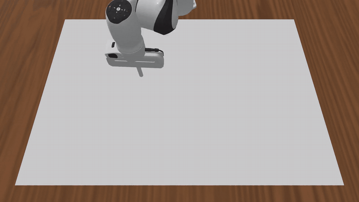
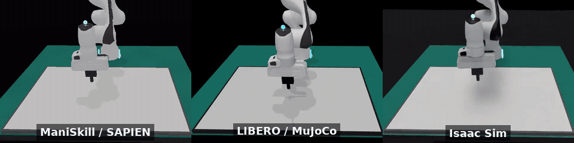
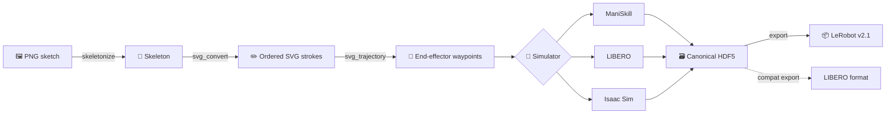
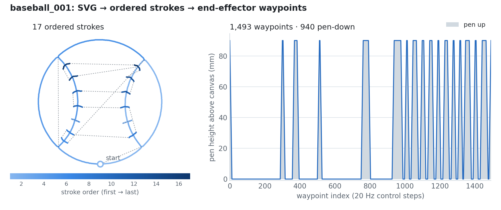
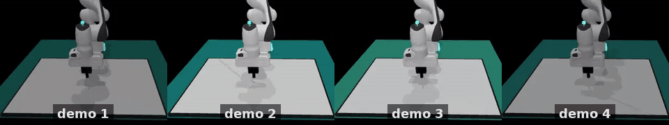
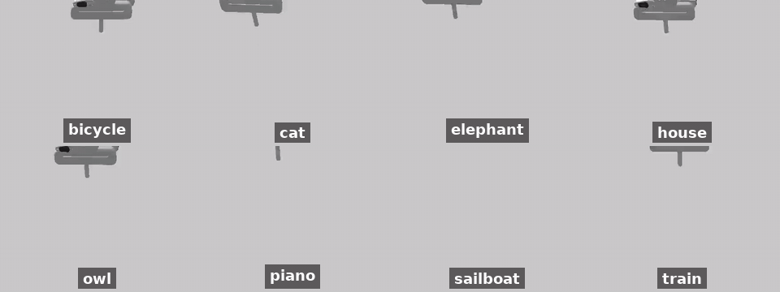
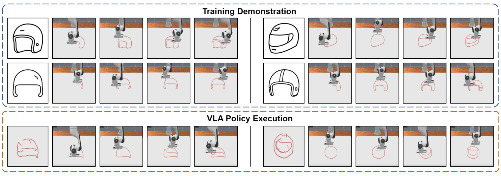
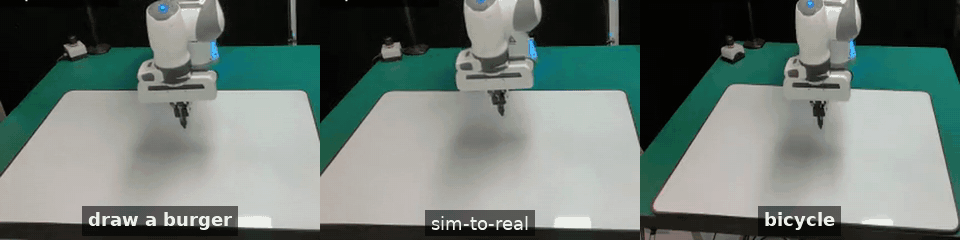

<div align="center">

# 🍔 BURGER

### Benchmarking and Understanding Robotic Generalization via Embodied dRawing

[](https://arxiv.org/abs/2610.40532)
[](https://siyingzhao.github.io/BURGER/)
[](https://huggingface.co/datasets/Zhaosying66/BURGER)
[](LICENSE)
<br>
[](#-quick-start)
[](https://github.com/haosulab/ManiSkill)
[](https://github.com/Lifelong-Robot-Learning/LIBERO)
[](https://github.com/isaac-sim/IsaacLab)
[](https://github.com/huggingface/lerobot)

[**Xiangyu Xu**](https://openreview.net/profile?id=~Xiangyu_Xu10)<sup>1\*</sup> ·
[**Bangshuai Peng**](https://openreview.net/profile?id=~Bangshuai_Peng1)<sup>1\*</sup> ·
[**Ziyi Liu**](https://taichi-pink.github.io/Ziyi-Liu/)<sup>1\*</sup> ·
[**Mengjie Zhao**](https://qxjyqzw.github.io/)<sup>1\*</sup> ·
[**Chenhao Lu**](https://ctp314.github.io/)<sup>1,2</sup> ·
**Zhengyang Fan**<sup>1</sup> ·
[**Huazhe Xu**](https://iiis.tsinghua.edu.cn/en/People/Faculty/XuHuazhe.htm)<sup>1,2†</sup> ·
[**Kaizhe Hu**](https://hukz18.github.io/)<sup>1,2†</sup>

<sup>1</sup>Tsinghua University · <sup>2</sup>Shanghai Qizhi Institute
<br>
<sup>\*</sup>Equal contribution · <sup>†</sup>Corresponding authors



</div>

## 📰 News

- **2026-10-30** 🚀 Released the data-generation code: sketches → ordered strokes → robot demonstrations in **ManiSkill, LIBERO and Isaac Sim** → LeRobot datasets.
- **2026-10** 📄 Paper on [arXiv](https://arxiv.org/abs/2610.40532) and the [BURGER dataset](https://huggingface.co/datasets/Zhaosying66/BURGER) on 🤗 Hugging Face.

## ✨ Overview

**Drawing is a manipulation task where language really matters.** A blank canvas
gives the policy no visual hint of what to do, and every instruction admits many
valid drawings and stroke orders. BURGER uses this to study how
vision-language-action (VLA) models learn diverse behaviors as data scale and
diversity grow.

- 🎨 **Multimodal by construction.** Each instruction has many correct drawings, so demonstrations cover several distinct behaviors (7.13 effective trajectory modes per instruction vs. 1.09 for LIBERO).
- 🧩 **Compositional.** 150 tasks place familiar objects in new spatial relations (left of, above, inside) to test language following.
- 🏭 **Scalable data.** One pipeline turns any line sketch into simulated demonstrations, with three interchangeable simulators.
- 📏 **Measurable quality.** A drawing metric built on frozen DINOv3 features agrees with human rankings (Spearman ρ 0.834 vs. 0.592 for CLIPScore).

> [!NOTE]
> **This repository contains the data-generation pipeline.** It covers PNG
> preprocessing, ordered SVG strokes, simulated demonstrations in three
> simulators, and dataset export. Prompt-to-image generation, the paper's exact
> splits, policy training and evaluation, and real-robot deployment are not part
> of this release.

## 🖥️ One pipeline, three simulators

<p align="center">
  
</p>

| Simulator | Physics / rendering | Python env | Setup | Verified |
|---|---|---|---|:---:|
| **ManiSkill** | SAPIEN 3.0.3 · Vulkan | 3.10 · `.venv-maniskill` | `bash scripts/setup_maniskill.sh` | ✅ |
| **LIBERO** | MuJoCo 2.3.7 · robosuite 1.4.1 · EGL | 3.10 · `.venv-libero` | `bash scripts/setup_libero.sh` | ✅ |
| **Isaac Sim** | Isaac Sim 6.1 · Isaac Lab · RTX | 3.12 · `.venv-isaac61` | `bash scripts/setup_isaac.sh` | ✅ |

All three record the same canonical HDF5 schema and export the same LeRobot
state/action convention. Scenes, cameras and rendering still differ between
simulators, so check visual consistency before mixing their data. *Verified* means installation, serial and
parallel generation, LeRobot export and full readback pass on a Linux GPU host;
see the [verification report](docs/VERIFICATION.md).

## 🧭 Getting started

| I want to… | Start here |
|---|---|
| Install everything and check my machine | [⚡ Quick start](#-quick-start) · [Usage §1–4](docs/USAGE.md#1-prepare-the-host) |
| Generate demonstrations from my own SVGs | [Usage §5](docs/USAGE.md#5-generate-your-own-data) |
| Turn my PNG sketches into ordered SVG strokes | [PNG → SVG](docs/USAGE.md#optional-png--svg) |
| Reproduce a published reference drawing | [Use a published reference SVG](docs/USAGE.md#use-a-published-reference-svg) |
| Export or re-export to LeRobot / LIBERO format | [Re-export existing data](docs/USAGE.md#optional-re-export-existing-data) |
| Understand the state and action vectors | [Data format](docs/DATA_FORMAT.md) |
| Download the BURGER dataset | [🤗 Zhaosying66/BURGER](https://huggingface.co/datasets/Zhaosying66/BURGER) |
| Verify all three simulators on a GPU server | [Run the complete verification](docs/USAGE.md#run-the-complete-verification) |
| Fix a failed install or run | [Troubleshooting](docs/USAGE.md#troubleshooting) |

## ⚡ Quick start

Simulation needs **Linux x86_64 with an NVIDIA GPU** (ManiSkill uses Vulkan,
LIBERO uses EGL, Isaac needs an RTX GPU and Ubuntu 22.04+). Preprocessing and
export also run on CPU-only machines. Each simulator gets its own isolated
environment, created with [uv](https://docs.astral.sh/uv/).

```bash
git clone https://github.com/Qxjyqzw/BURGER.git && cd BURGER

# Shared tools: preprocessing, checks and LeRobot export
bash scripts/setup_cpu.sh
bash scripts/setup_export.sh

# One simulator (or all three)
bash scripts/setup_maniskill.sh    # or setup_libero.sh / setup_isaac.sh

# Generate three test drawings, export LeRobot and read it back
bash scripts/verify_backend.sh maniskill
```

Then generate demonstrations for one language instruction from a folder of SVGs:

```bash
bash scripts/generate.sh \
  --backend maniskill \
  --svg_dir examples/svg --output_dir outputs \
  --object_name geometric_shapes \
  --source_desc "draw the supplied geometric sketch" \
  --parallel 2 --seed 7 --format canonical,lerobot \
  --lerobot_repo_name shapes-v1
```

> [!IMPORTANT]
> **Isaac Sim** asks you to accept the
> [NVIDIA Omniverse EULA](https://docs.omniverse.nvidia.com/platform/latest/common/NVIDIA_Omniverse_License_Agreement.html)
> on first launch. After reviewing it, set `export OMNI_KIT_ACCEPT_EULA=YES` in
> the shell that runs generation; the scripts never accept it for you.

The [usage guide](docs/USAGE.md) explains system packages, every option, output
layout and provenance in detail.

## 🔬 How it works



1. **Sketch → strokes.** `burger.preprocess` skeletonizes a line drawing and orders its paths into SVG strokes.
2. **Strokes → waypoints.** `burger.pipeline.svg_trajectory` densifies each stroke, inserts pen lifts between strokes, and maps the drawing onto the canvas.
3. **Waypoints → demonstrations.** A simulator backend tracks the waypoints with a pen-tipped Franka Panda and records cameras, robot state and ink.
4. **Demonstrations → datasets.** Every run is saved as canonical HDF5 with full provenance, then exported to LeRobot.

<p align="center">
  
  <br>
  <em>The published <code>baseball_001.svg</code> reference: 17 ordered strokes become 1,493 waypoints, 940 of them with the pen on the canvas.</em>
</p>

One instruction admits many valid drawings, which is what makes the data
multimodal. Four training demonstrations of *draw a helmet* use different
helmets, stroke orders and routes:

<p align="center">
  
</p>

### 📦 Data format

| | Dim | Contents |
|---|:---:|---|
| `observation.state` | 8 | pen-tip XYZ (ManiSkill world frame), end-effector quaternion WXYZ, previous end flag |
| `action` | 8 | absolute target XYZ (robot base frame), Euler `π, 0, 0`, pen/gripper `1`, end flag |
| `observation.image` | 128×128×3 | front camera |
| `observation.wrist_image` | 128×128×3 | wrist camera |

Units are metres and radians; control runs at 20 Hz. The end flag marks the last
five steps and is not a success label. See [DATA_FORMAT.md](docs/DATA_FORMAT.md)
before mixing exports with older datasets.

## 🗂️ The BURGER dataset

<p align="center">
  
</p>

| | Count |
|---|---:|
| Simulated demonstrations | **28,200** |
| Single-object tasks | 132 |
| Compositional tasks (100 horizontal, 50 vertical) | 150 |
| Demonstrations per task | 100 |
| Original reference SVGs | 132 |

The dataset is on [🤗 Hugging Face](https://huggingface.co/datasets/Zhaosying66/BURGER).
It contains several historical formats; the
[published-data review](docs/PUBLISHED_DATASET_REVIEW.md) explains how they relate
to this code release.

## 📊 Results at a glance

<p align="center">
  
</p>

- VLA policies trained on BURGER learn **more than one drawing behavior** for the same instruction.
- π₀ and π₀.₅ improve more consistently with data scale than π₀-FAST.
- Policies compose known objects in new spatial relations but still struggle with unseen categories.
- On a real Franka Panda, a fine-tuned π₀.₅ draws with visual feedback, completing sketches and responding to strokes added by a person.

<p align="center">
  
  <br>
  <em>Real-robot drawing. Real-robot code is not part of this release.</em>
</p>

More results, videos and analysis are on the [project page](https://siyingzhao.github.io/BURGER/).

## 📁 Repository layout

```text
burger/
├── pipeline/            # generation orchestration, SVG trajectories, appearance
├── preprocess/          # PNG skeletonization and ordered SVG construction
├── backends/
│   ├── maniskill/       # ManiSkill environment, adapter, episode recorder
│   ├── libero/          # LIBERO environment, workers, scene assets
│   └── isaac/           # Isaac environment, worker, kinematics, scene assets
└── data/                # canonical schema, validation, readback, exporters
scripts/                 # environment setup, generation and verification
examples/svg/            # small drawings for installation checks
docs/                    # usage guide, data contract, verification reports
```

`bash scripts/generate.sh --backend …` selects the simulator's environment and
runs `python -m burger generate`. The same entry point provides `export`,
`check` and `import-maniskill`; run `.venv-cpu/bin/python -m burger --help`
after setup.

## 🙏 Acknowledgements

BURGER builds on [ManiSkill](https://github.com/haosulab/ManiSkill) and
[SAPIEN](https://github.com/haosulab/SAPIEN),
[LIBERO](https://github.com/Lifelong-Robot-Learning/LIBERO),
[robosuite](https://github.com/ARISE-Initiative/robosuite) and
[MuJoCo](https://github.com/google-deepmind/mujoco),
[Isaac Sim](https://developer.nvidia.com/isaac/sim) and
[Isaac Lab](https://github.com/isaac-sim/IsaacLab),
[LeRobot](https://github.com/huggingface/lerobot) and
[OpenPI](https://github.com/Physical-Intelligence/openpi).
We thank their authors for making them openly available.

## 📜 License

The source code is released under the [MIT License](LICENSE). Simulators,
datasets and bundled assets keep their own terms: some robot meshes and
textures derive from ManiSkill assets under
[CC BY-NC 4.0](LICENSES/CC-BY-NC-4.0.txt). See
[THIRD_PARTY_NOTICES.md](THIRD_PARTY_NOTICES.md) for details.

## 📝 Citation

If you find BURGER useful, please cite:

```bibtex
@misc{xu2026burger,
  title = {{BURGER}: Benchmarking and Understanding Robotic Generalization via Embodied dRawing},
  author = {Xu, Xiangyu and Peng, Bangshuai and Liu, Ziyi and Zhao, Mengjie and Lu, Chenhao and Fan, Zhengyang and Xu, Huazhe and Hu, Kaizhe},
  year = {2026},
  eprint = {2610.40532},
  archivePrefix = {arXiv},
  url = {https://arxiv.org/abs/2610.40532}
}
```
